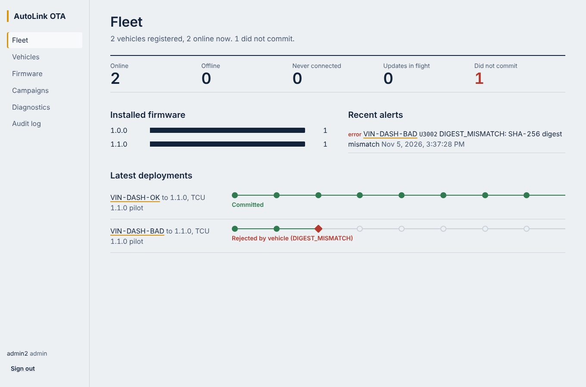

# AutoLink OTA

A secure over-the-air firmware update platform for connected vehicles, built as an engineering portfolio project.
A simulated C++17 ECU receives Ed25519-signed firmware from a Python backend, verifies it independently, stages it
into an A/B slot, health-checks it and commits or rolls back. Operators manage vehicles, releases and campaigns
in a React/TypeScript dashboard. A fault-injection harness runs the real stack through power loss, process kills
and network faults.

This is an educational research prototype. It makes no claims of certification, regulatory compliance, AUTOSAR
implementation or production readiness.



## Verified status

| Area | State | Evidence |
|---|---|---|
| ECU simulator (C++17, OpenSSL) | Builds with `-Werror`; 32/32 unit tests | `docs/verification/test-results.md` |
| Backend (REST, auth, RBAC, audit) | 28/28 tests | same |
| Backend ↔ ECU binary over HTTP | 5/5 integration tests | same |
| Dashboard in Chromium | 10/10 browser checks, 8/8 unit tests | same, `docs/portfolio/screenshots/` |
| Fault injection | 175/175 executions met expectations, 0 consistency violations | `docs/verification/fault-injection-report.md` |
| CMake/GoogleTest, Docker, Terraform, CI | Written, **not executed** | `docs/known-limitations.md` |
| TLS, MQTT, PostgreSQL | **Not implemented** | same |

The brief specified FastAPI, PostgreSQL, MQTT and Vite. The build environment was offline, so the verified
system uses Flask, SQLite, an HTTP vehicle channel and an esbuild build instead, with the migration path
documented. Every claim in the documentation is backed by a test or labelled as unverified.

## Quick start

Requirements: g++ ≥ 11, make, OpenSSL 3 dev headers, Python 3.12, Node ≥ 20.

```bash
pip install -r backend/requirements.txt
make ecu                                   # ECU simulator + tests
(cd frontend && npm install && npm run build)
make setup                                 # dev key, trust store, secrets, accounts in .dev/
make serve                                 # http://127.0.0.1:8000
```

In a second terminal, register a vehicle, release firmware and run the update:

```bash
python3 scripts/demo.py register VIN-DEMO-001
python3 scripts/demo.py release 1.1.0
python3 scripts/demo.py campaign fw-tcu-1.1.0 VIN-DEMO-001     # engineer drafts, a second admin approves
AUTOLINK_DEVICE_TOKEN=$(cat .dev/ecu-VIN-DEMO-001.token) \
  ecu/build-make/autolink-ecu --config .dev/ecu-VIN-DEMO-001.json --exit-after-update
python3 scripts/demo.py status VIN-DEMO-001                     # firmware 1.1.0, SUCCEEDED
```

Try `python3 scripts/demo.py release 1.2.0 --corrupt` to see a rejected package, or add `--crash-after ACTIVATING`
to the ECU command to simulate power loss (run it again without the flag to watch the rollback).

## Tests and evidence

```bash
make test                               # all suites
make experiments                        # 175-run fault matrix (about 4 min)
python3 scripts/collect_evidence.py     # regenerates docs/verification/* and evidence/test-results.json
```

## How it works

- **Trust:** the ECU trusts only its own trust store. It checks the signature, hardware target, version,
  anti-rollback counter and SHA-256 before staging, so a compromised server cannot get an image activated.
- **Crash safety:** every state change is written atomically before the next step; on boot a recovery supervisor
  resumes the update or rolls back an unconfirmed activation.
- **Delivery:** commands and events are at-least-once with idempotent consumers (sequence numbers, unique keys),
  never assuming exactly-once.
- **Operations:** two-person campaign approval, per-vehicle device credentials, audit of every sensitive action,
  and a lifecycle rail in the dashboard that shows where each update stopped.

## Repository map

| Path | Contents |
|---|---|
| `ecu/` | C++17 simulator: state machine, OTA agent, OpenSSL crypto, persistence, HTTP client, tests |
| `backend/` | Flask app (`api/`, `services/`, `repositories/`, `security/`, `storage/`), SQL migrations, tests |
| `frontend/` | React/TypeScript dashboard, Playwright end-to-end script, unit tests |
| `firmware/tools/` | `autolink_fw.py`: key generation, signing, verification |
| `experiments/` | Harness (`stack.py`), matrix runner, scenario definitions, recorded results |
| `tests/integration/` | Cross-component and browser end-to-end tests |
| `infrastructure/` | Dockerfiles, Terraform (AWS S3, CloudWatch, IAM) |
| `scripts/` | Dev setup, demo, evidence collection, fixture generation |
| `docs/` | Architecture, API, security, requirements, verification, deployment, portfolio |

## Documentation

- Architecture: [overview](docs/architecture/overview.md), [state machine](docs/architecture/ota-state-machine.md),
  [database](docs/architecture/database-schema.md), [standards notes](docs/architecture/standards-notes.md)
- Interfaces: [REST API](docs/api/rest-api.md), [vehicle protocol and MQTT design](docs/api/vehicle-protocol.md)
- Security: [threat model](docs/security/threat-model.md), [design decisions](docs/security/security-design.md)
- Requirements: [specification](docs/requirements/srs.md), [traceability](docs/requirements/traceability.md)
- Verification: [test plan](docs/verification/test-plan.md), [test results](docs/verification/test-results.md),
  [fault injection](docs/verification/fault-injection-report.md)
- Operations: [local setup](docs/deployment/local-setup.md), [AWS](docs/deployment/aws-deployment.md),
  [troubleshooting](docs/deployment/troubleshooting.md), [known limitations](docs/known-limitations.md)
- Portfolio: [demo script](docs/portfolio/demo-script.md), [interview prep](docs/portfolio/interview-prep.md),
  [resume material](docs/portfolio/resume.md)

## License

MIT, see `LICENSE`.
