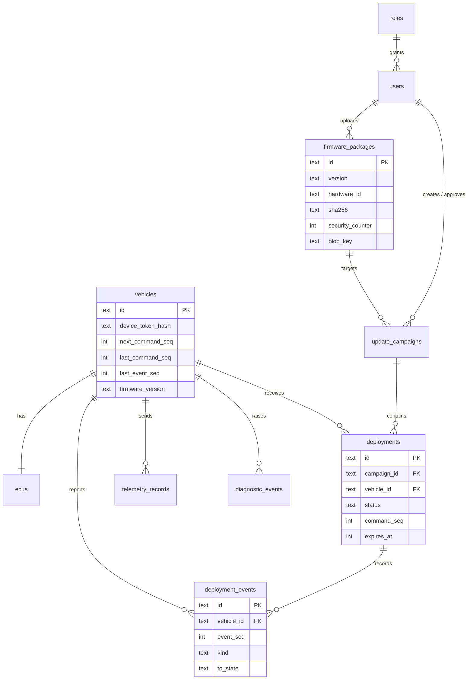

# Database schema

Migrations: `backend/migrations/0001_initial.sql`, `0002_vehicle_event_watermark.sql`, applied in order by
`Database.migrate` and recorded in `schema_migrations`. SQLite runs with foreign keys on, WAL journaling and
`synchronous=FULL`.

## Constraints that carry security or correctness weight

| Constraint | Purpose |
|---|---|
| `deployment_events UNIQUE (vehicle_id, event_seq)` | Idempotent ingestion of retried events (REQ-BE-003) |
| `diagnostic_events UNIQUE (vehicle_id, event_seq)` | Same, for DTCs; cloud events use NULL `event_seq` |
| `deployments UNIQUE (vehicle_id, command_seq)` | One command per sequence number per vehicle |
| `deployments UNIQUE (campaign_id, vehicle_id)` | A vehicle appears once per campaign |
| `firmware_packages UNIQUE (hardware_id, version)` | No two different images share a version |
| `users UNIQUE (username)`, `users.role FK roles` | Role values constrained |
| `vehicles.last_event_seq` | Watermark so out-of-order events never regress the reported firmware version |

Indexes cover deployments by vehicle and status, events by deployment, and telemetry, diagnostics and audit by time.
