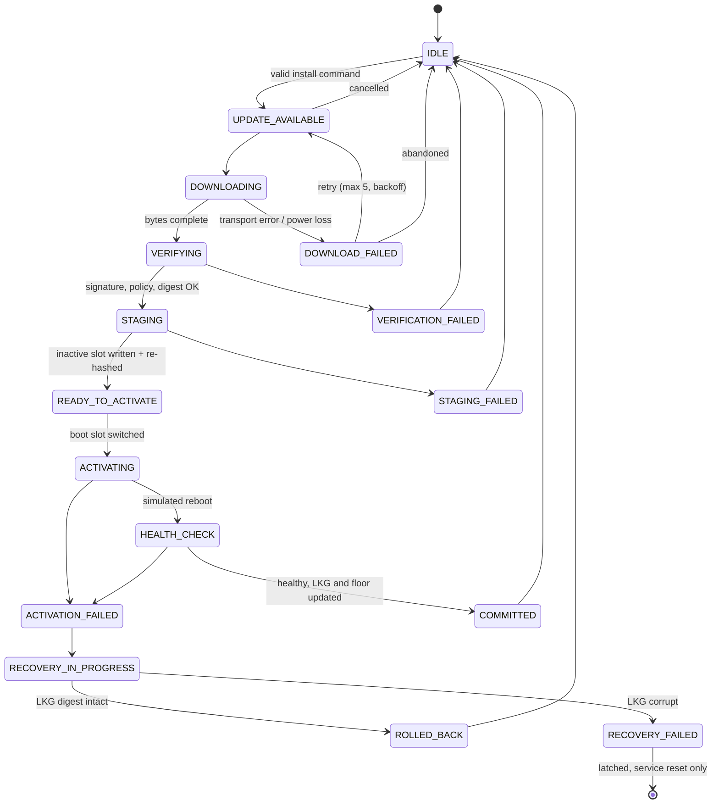

# OTA update state machine

Source of truth: `ecu/src/update_state.cpp`. Any transition not listed is rejected with `InvalidTransition`
(REQ-ECU-002), so the code cannot, for example, move from DOWNLOADING to STAGING without VERIFYING (UT004).

## Persistence rule

`OtaAgent::transition` validates the transition, appends to the fsync'd journal, then writes `state.json` with
temp file, `fsync`, `rename`, directory `fsync`. Slot changes that belong to a transition (for example the boot-slot
switch on entering ACTIVATING) are saved in the same atomic write. A crash therefore leaves the previous or the
new complete state, never a mixture. The journal may be one entry ahead of `state.json`.

## Behaviour after restart (recovery supervisor)

| Persisted state | Action on boot | Evidence |
|---|---|---|
| IDLE, RECOVERY_FAILED | none | |
| UPDATE_AVAILABLE | start download | |
| DOWNLOADING | record DOWNLOAD_FAILED (INTERRUPTED), retry; resumes from the partial file with HTTP Range | UT070, EXP:power_loss_downloading, EXP:process_kill |
| VERIFYING | re-verify from scratch | EXP:power_loss_verifying |
| STAGING | re-stage (idempotent temp+rename) | UT071, EXP:power_loss_staging |
| READY_TO_ACTIVATE | activate | EXP:power_loss_ready_to_activate |
| ACTIVATING, HEALTH_CHECK | treat as unconfirmed boot: ACTIVATION_FAILED, roll back | UT072, UT073, IT004, EXP:power_loss_activating/health_check |
| COMMITTED, ROLLED_BACK, *_FAILED | finish to IDLE | UT074 |

Rolling back an unconfirmed boot is a deliberate, conservative choice that mirrors A/B bootloaders with a
boot-confirmation flag. An alternative would retry the health check a bounded number of times.

## Commands and anti-replay

A command is `{seq, type, vehicle_id, deployment_id, firmware_id, expires_at}`. The ECU executes it only if
`seq > last_command_seq`, the vehicle id matches, it has not expired, identifiers are safe, and the ECU is IDLE.
`last_command_seq` is advanced even for rejected commands, so a command is never executed twice (UT055, UT056).

## Simulated versus real guarantees

The simulator models A/B slots as files and "reboot" as a state change. It does not provide secure boot, a
hardware root of trust, rollback-protected monotonic counters (the anti-rollback floor is in a writable file),
flash wear handling or bootloader integration. On real hardware the floor would live in OTP fuses or an RPMB
partition, and image authenticity would be re-checked by the bootloader at every boot.
