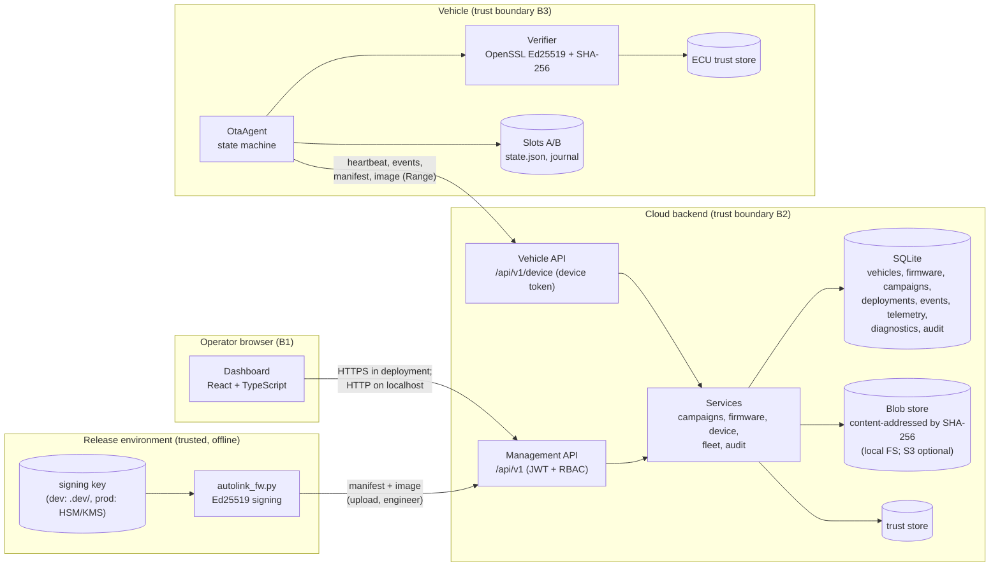
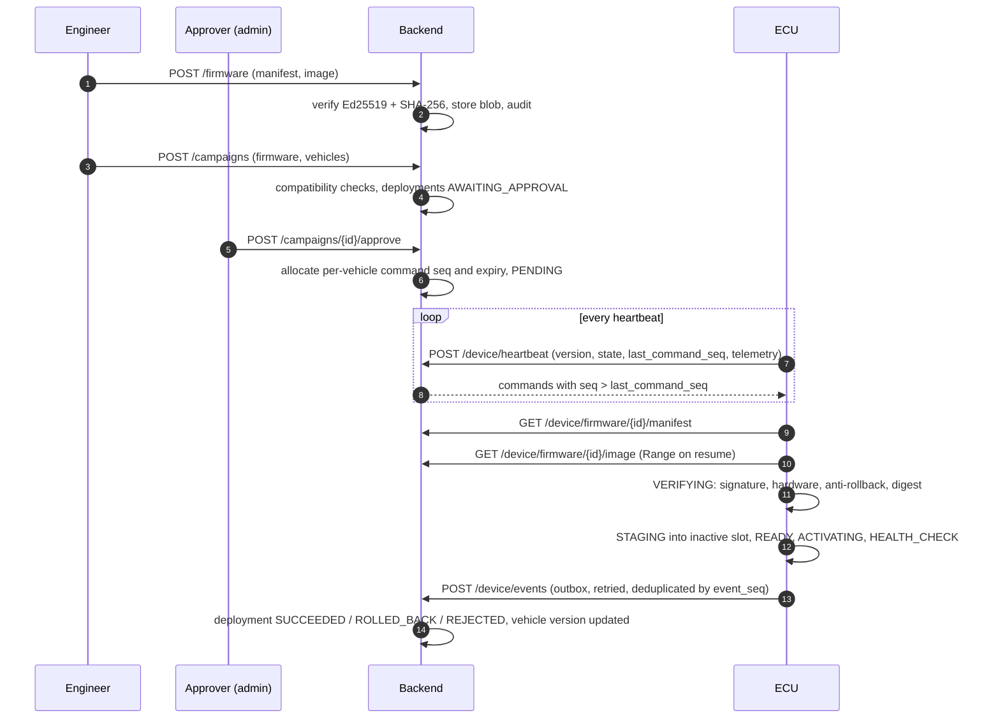

# Architecture overview

AutoLink OTA has three runtime parts: a simulated vehicle ECU (C++17), a cloud backend (Python/Flask + SQLite),
and a web dashboard (React/TypeScript) served by the backend. A release tool signs firmware offline.

## Components, trust boundaries and data flows

Trust boundaries:

- **B1 operator to cloud.** Users authenticate with short-lived HS256 JWTs. Every request re-reads the user's role
  from the database. Approval of a campaign requires a second administrator.
- **B2 cloud internals.** The backend verifies firmware signatures on upload, but the backend is *not* the root of
  trust: a compromised backend cannot produce firmware the ECU will accept without the signing key.
- **B3 vehicle.** The ECU trusts only its own trust store. It re-verifies signature, policy and digest locally,
  so a malicious server, a man-in-the-middle, or a corrupted download cannot get an image staged.

## Update sequence

## Failure domains

| Domain | Failure | Effect and containment |
|---|---|---|
| ECU process | crash, power loss, SIGKILL | State is persisted before each step; on boot the recovery supervisor resumes or rolls back (`resume_after_boot`). |
| ECU storage | corrupt slot image | Health check and recovery verify slot digests; corrupt last-known-good latches RECOVERY_FAILED for service. |
| Link | loss, latency, truncation, outage | Bounded retries with backoff, HTTP Range resume, events queued in a persistent outbox. |
| Backend process / DB | restart | ECU keeps retrying; SQLite in WAL mode with FULL sync; deployment state is rebuilt from idempotent events. |
| Backend compromise | malicious commands or images | Images still need a valid signature from a key in the ECU trust store; anti-rollback floor on the ECU. |
| Signing key compromise | attacker signs firmware | Not prevented by this design; mitigated by revocation lists in trust stores (see threat model T-14). |

## Code map

| Concern | Location |
|---|---|
| State machine | `ecu/src/update_state.cpp` |
| Update orchestration, recovery | `ecu/src/ota_agent.cpp` |
| Signature, digest, policy | `ecu/src/manifest.cpp`, `ecu/src/crypto.cpp` |
| Atomic persistence, journal | `ecu/src/ecu_state.cpp` |
| HTTP transport (replaceable) | `ecu/src/http_link.cpp` behind `CloudLink` |
| REST routes | `backend/app/api/` |
| Business rules | `backend/app/services/__init__.py` |
| SQL | `backend/app/repositories/__init__.py`, `backend/migrations/` |
| Dashboard | `frontend/src/` |
| Harness and experiments | `experiments/runner/` |

## Stack substitutions

The project brief named FastAPI, Pydantic, SQLAlchemy/Alembic, PostgreSQL, MQTT, CMake/GoogleTest, Vite, React
Router, TanStack Query and Recharts. The build environment had no network access, so none could be installed.
Rather than ship code that had never run, the verified build uses Flask, a small validator, raw SQL migrations,
SQLite, HTTP for the vehicle channel, a Makefile with a GoogleTest-compatible harness, esbuild, and small in-house
routing, data-fetching and chart modules. The layering (routes, services, repositories) maps one-to-one onto a
FastAPI/SQLAlchemy design; see `docs/known-limitations.md` for the migration path.
